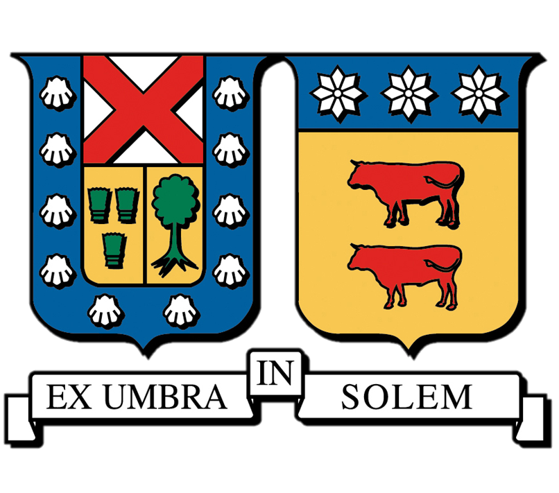

<table width="100%">
  <tr>
    <td align="left" width="25%">
      
    </td>
    <td align="center" width="50%">
      <h1> Portafolio </br> INF449
</h1>
    </td>
    <td align="right" width="25%">
      
    </td>
  </tr>
</table>

</br>


Portafolio de entregables de la asignatura **INF449 Fotografía Computacional – UTFSM**: tareas, exposiciones y proyecto final.

## Evaluación

| Entregable | Ponderación |
|---|---:|
| Tareas | 40% |
| Exposición | 20% |
| Proyecto final | 40% |

## Tareas

Cada carpeta contiene el enunciado (`homeworkXX.pdf`), el notebook con los análisis (`homeworkXX.ipynb`), el informe en LaTeX (`informe.tex`) y compilado (`informe.pdf`), además de figuras (`Fig/`) y resultados.

| Tarea | Tema | De qué trata | Carpeta | Informe |
|---|---|---|---|---|
| 1 | Demosaicking con filtro Bayer | Reconstrucción de imágenes en color a partir de un mosaico Bayer RGGB (24 imágenes Kodak) con interpolación bilineal; bonus con el método de Malvar (2004). Se evalúa con PSNR y SSIM. | [tareas/tarea-01](tareas/tarea-01/) | [informe.pdf](tareas/tarea-01/informe.pdf) |
| 2 | Demosaicking neuronal (CNN y SIREN) | Reemplazo de la interpolación clásica por una CNN y por una representación neuronal implícita (SIREN) entrenadas con PyTorch; comparación con los métodos de la tarea 1. | [tareas/tarea-02](tareas/tarea-02/) | [informe.pdf](tareas/tarea-02/informe.pdf) |
| 3 | Escasez en imágenes: Wavelet y DCT | Análisis de la compresibilidad de imágenes en las bases Wavelet y DCT, y su reconstrucción a partir de pocos coeficientes. | [tareas/tarea-03](tareas/tarea-03/) | [informe.pdf](tareas/tarea-03/informe.pdf) |
| 4 | Elementos difractivos y deconvolución | Simulación de difracción y polinomios de Zernike para generar PSF, desenfoque de imágenes (dataset McMaster) y recuperación con deconvolución (Wiener y Richardson-Lucy). | [tareas/tarea-04](tareas/tarea-04/) | [informe.pdf](tareas/tarea-04/informe.pdf) |
| 5 | PCA para imágenes multiespectrales | Compresión de imágenes multiespectrales (seis bandas de Washington D. C. y diez imágenes de Tokio) mediante componentes principales; métricas PSNR, SSIM y SAM. | [tareas/tarea-05](tareas/tarea-05/) | [informe.pdf](tareas/tarea-05/informe.pdf) |
| 6 | Recuperación de fase con iluminación codificada | Recuperación de amplitud y fase de un objeto a partir de intensidades medidas con máscaras codificadas complementarias (L=4 y L=16), usando el algoritmo HIO (Hybrid Input-Output). | [tareas/tarea-06](tareas/tarea-06/) | [informe.pdf](tareas/tarea-06/informe.pdf) |

## Exposiciones

Presentación de dos artículos relacionados con el proyecto final. En cada carpeta están el artículo y la presentación.

| Exposición | Artículo | Carpeta |
|---|---|---|
| 1 | *Making Fisherwork: Train-Time Compression for 3D Gaussian Splatting*: compresión durante el entrenamiento de representaciones 3D Gaussian Splatting. | [exposicion/paper-01](exposicion/paper-01/) (artículo y [presentación](exposicion/paper-01/01_presentacion.pdf)) |
| 2 | *SCIPS: Single-Shot Photometric Stereo from a Snapshot Compressed Multispectral Image*: estéreo fotométrico a partir de una sola captura multiespectral comprimida. | [exposicion/paper-02](exposicion/paper-02/) (artículo y [presentación](exposicion/paper-02/02_presentacion.pdf)) |

## Proyecto final

El proyecto final se encuentra en <https://github.com/fralfaro/spc-gs>; ahí está el detalle completo.

## Estructura

```text
inf449-portafolio/
├── tareas/           # Tareas 1 a 6 (informe, notebook y resultados)
├── exposicion/       # Artículos y presentaciones (paper-01, paper-02)
├── files/            # Programa y clases del curso
├── img/              # Imágenes del repositorio
├── LICENSE
└── README.md
```

## Fuente

Información general del curso en el programa de asignatura: [`files/inf449.pdf`](files/inf449.pdf).
